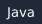
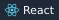
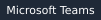
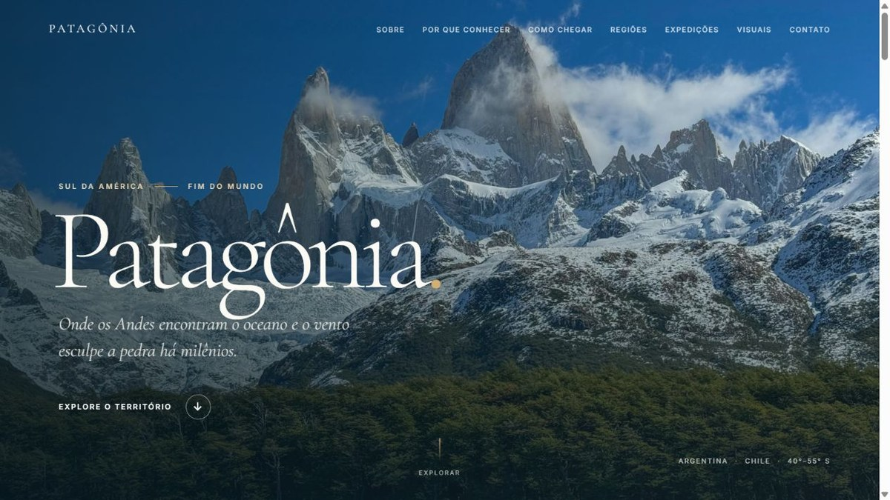
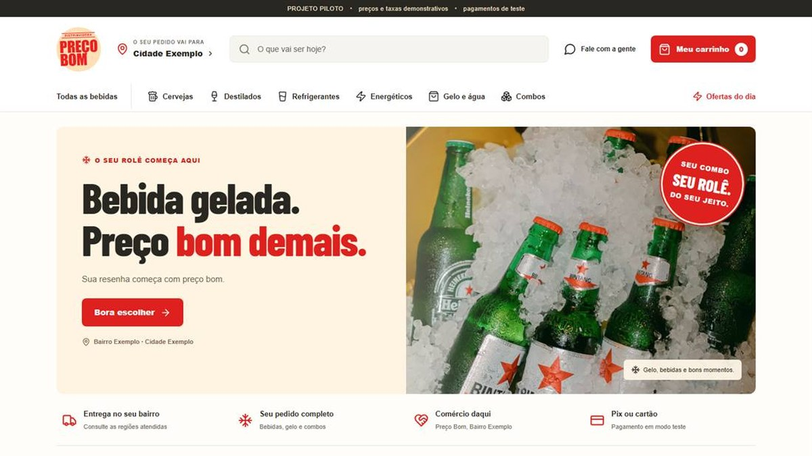

<picture>
  <source media="(max-width: 600px)" srcset="./assets/profile-header-mobile.svg" />
  
</picture>

  

[Competências](#competências-e-ferramentas) · [Projetos](#projetos-em-destaque) · [Experiência](#experiência-prática)

---

## Sobre mim

Sou **Breno Ludgerio**, estudante de **Análise e Desenvolvimento de Sistemas na FAESA**. Minha trajetória conecta desenvolvimento de software, automação e infraestrutura: atuo em IT Service Management na **Vale S.A.** e tenho experiência em suporte técnico de redes N1/N2.

Sou também **cofundador e responsável pelo desenvolvimento web da [Zenix Digital](https://zenixworks.com/)**, onde participo das decisões técnicas e transformo ideias em sites e aplicações funcionais.

## Competências e ferramentas

### Programação e desenvolvimento web

  
  
  
  

**Fundamentos:** HTML5, CSS3, interfaces responsivas e APIs REST.  
**Nos projetos:** React, TypeScript, Vite e Hono; Node.js em scripts e ferramentas de desenvolvimento.

### ITSM e automação

  
  
  

**Processos:** Incident Management, Problem Management, testes e validações.  
**Implementação:** Business Rules, Scheduled Script Executions, Flow Designer, UI Policies, Adaptive Cards, integrações e JSON.

### Redes e infraestrutura

  
  

**Atuação:** suporte remoto N1/N2, configuração de roteadores e diagnóstico de conectividade.  
**Operação:** monitoramento de redes, acompanhamento de alertas e investigação de falhas.

### Dados e ferramentas de desenvolvimento

  
  
  

**Dados:** SQL, T-SQL e SharePoint.  
**Ferramentas:** GitHub, Visual Studio Code, versionamento e documentação técnica.

### Cloud e publicação

  
  

**Nos projetos:** publicação de sites estáticos e aplicações web; Workers e D1 local na demonstração da distribuidora.

---

## Projetos em destaque

Uma seleção de interfaces web e automações que mostram minha atuação em desenvolvimento e ITSM.

### Patagônia — expedição ao fim do mundo

Site editorial responsivo com destinos, galeria, vídeo local e formulário demonstrativo. **Projeto acadêmico** publicado no GitHub Pages.

**Stack:** HTML · CSS · JavaScript  
[Repositório](https://github.com/ludgerios/site-patagonia-turismo) · [Demonstração online](https://ludgerios.github.io/site-patagonia-turismo/)

### Distribuidora Preço Bom

Aplicação de catálogo, carrinho, pedidos e painel administrativo. **Demonstração com dados fictícios, pagamentos MOCK e D1 local**, sem conexão com a operação da loja.

**Stack:** React · TypeScript · Vite · Hono · Cloudflare Workers  
[Repositório e execução local](https://github.com/ludgerios/distribuidora-preco-bom)

### ServiceNow — notificações de Problem Tasks

Scheduled Job para acompanhar prazos e disparar eventos de notificação por e-mail e Microsoft Teams. O código público usa identificadores demonstrativos e exige configuração de uma instância própria.

**Stack:** JavaScript · ServiceNow · GlideRecord · GlideDateTime  
[Código e documentação](https://github.com/ludgerios/ServiceNow-Problem-Task-Notification-Job)

### Power Automate — notificações de compliance

Laboratório de notificações pelo Teams, com Adaptive Cards e registro de envios. **Usa dados fictícios**; o fluxo pai tem pacote importável, e a documentação descreve a evolução do fluxo filho.

**Stack:** Power Automate · Excel Online · Microsoft Teams · Adaptive Cards  
[Pacote e documentação](https://github.com/ludgerios/power-automate-compliance-notifications-)

---

## Experiência prática

### Vale S.A. — IT Service Management

**Estágio atual em ITSM**, com foco em automações, integração entre ferramentas e melhoria de processos.

- Desenvolvimento de scripts, regras e notificações no ServiceNow; automações com Power Automate e Microsoft Teams.
- Trabalho com APIs REST, SQL Server, Azure DevOps e SharePoint; testes funcionais, validação de regras de negócio e documentação técnica.

### Suporte técnico de redes — N1/N2

Experiência em atendimento técnico por call center, suporte remoto e resolução de problemas de conectividade.

- Diagnóstico de falhas, orientação a usuários e configuração de roteadores.
- Uso de IXC Soft no atendimento e Zabbix no monitoramento de redes e acompanhamento de alertas.

### Zenix Digital — desenvolvimento web

**Cofundador e responsável pelo desenvolvimento web**, com participação na criação do nome e na evolução do conceito comercial da empresa.

- Criação de interfaces, sites, landing pages e aplicações responsivas; implementação de funcionalidades e melhorias de UI/UX.
- Participação nas decisões técnicas, hospedagem, publicação e evolução dos projetos digitais.

[Conheça a Zenix Digital](https://zenixworks.com/)

---

## Atividade no GitHub

  

---

**Breno Ludgerio** · [GitHub](https://github.com/ludgerios) · [LinkedIn](https://www.linkedin.com/in/breno-ludgerio-450070369/)  
Cofundador e responsável pelo desenvolvimento web · [Zenix Digital](https://zenixworks.com/)

