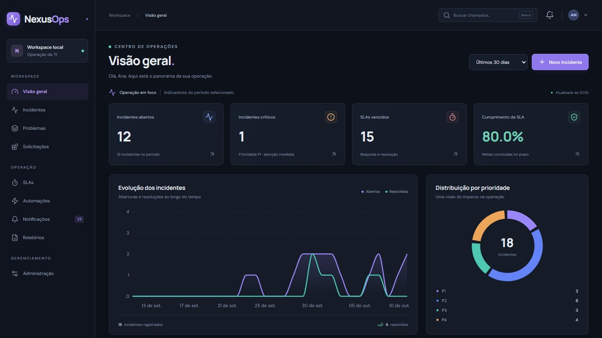

<picture>
  <source media="(max-width: 900px)" srcset="./assets/profile-header-mobile.svg" />
  
</picture>

[Projetos](#projetos-em-destaque) · [Outros projetos](#outros-projetos) · [Competências](#competências-e-ferramentas) · [Como trabalho](#da-ideia-à-implementação)

[LinkedIn](https://www.linkedin.com/in/breno-ludgerio-450070369/) · [Zenix Digital](https://zenixworks.com/)

## Sobre mim

Sou **Breno Ludgerio**, estudante de **Análise e Desenvolvimento de Sistemas na FAESA** e **ITSM Intern na Vale S.A.** Tenho experiência em suporte de redes N1/N2 e conecto desenvolvimento de software, automação e infraestrutura.

Sou também **CEO Executivo e cofundador da [Zenix Digital](https://zenixworks.com/)**, onde atuo no desenvolvimento web, participo das decisões técnicas e transformo ideias em sites e aplicações funcionais.

## Projetos em destaque

### 01 — NexusOps

Plataforma full stack de gestão de serviços de TI, com incidentes, problemas, solicitações, SLAs, notificações e administração por perfil. O dashboard consulta registros persistidos por uma API autenticada.

**Diferenciais técnicos:** monólito modular, migrations SQL, autorização no backend, sessões com proteção CSRF e testes de API e navegador em CI para Windows e Ubuntu. Demonstração local com dados fictícios.

**Tecnologias:** React · TypeScript · Node.js · Fastify · SQLite · Vitest · Playwright 
[Repositório](https://github.com/ludgerios/nexusops) · [Arquitetura](https://github.com/ludgerios/nexusops/tree/main/docs/architecture) · [Executar demonstração local](https://github.com/ludgerios/nexusops#executar-no-windows)

---

### 02 — Distribuidora Preço Bom

Sistema web demonstrativo de delivery, com catálogo, carrinho, checkout, acompanhamento de pedidos e painel administrativo. Produtos e pedidos são persistidos no D1 local para explorar o fluxo completo da aplicação.

**Diferenciais técnicos:** API em Worker, validação com Zod, autenticação administrativa e testes com Vitest e Playwright. Dados fictícios e pagamentos simulados; a demonstração é independente da operação da loja.

**Tecnologias:** React · TypeScript · Vite · Hono · Cloudflare Workers · D1 
[Repositório](https://github.com/ludgerios/distribuidora-preco-bom) · [Arquitetura](https://github.com/ludgerios/distribuidora-preco-bom/blob/main/ARCHITECTURE.md) · [Executar demonstração local](https://github.com/ludgerios/distribuidora-preco-bom#executar-localmente)

---

### 03 — Patagonia

Website editorial responsivo sobre a Patagônia, com destinos, expedições, galeria de imagens WebP e vídeo MP4 local. Projeto acadêmico de frontend publicado no GitHub Pages, com foco na navegação e na experiência visual.

**Diferenciais técnicos:** HTML semântico, CSS responsivo e JavaScript nativo, com menu acessível, indicação da seção ativa e suporte a movimento reduzido. O formulário é demonstrativo, com validação no navegador.

**Tecnologias:** HTML5 · CSS3 · JavaScript · GitHub Pages 
[Repositório](https://github.com/ludgerios/site-patagonia-turismo) · [Demonstração online](https://ludgerios.github.io/site-patagonia-turismo/) · [Documentação](https://github.com/ludgerios/site-patagonia-turismo#readme)

## Outros Projetos

- **[ServiceNow — notificações de Problem Tasks](https://github.com/ludgerios/ServiceNow-Problem-Task-Notification-Job)** — Scheduled Job que consulta tarefas e dispara eventos para notificações por e-mail e Teams. Exige configuração em uma instância própria. 
  **Tecnologias:** JavaScript · ServiceNow · GlideRecord · GlideDateTime

- **[Power Automate — notificações de compliance](https://github.com/ludgerios/power-automate-compliance-notifications-)** — Laboratório com fluxo pai importável, validações, Adaptive Cards e registro de envios. Dados fictícios; o fluxo filho está documentado como evolução. 
  **Tecnologias:** Power Automate · Excel Online · Microsoft Teams · Adaptive Cards

- **[Bot Discord](https://github.com/ludgerios/botdiscord)** — Bot de estudos com comandos utilitários, eventos de membros e calculadora aritmética limitada por AST. 
  **Tecnologias:** Python · discord.py

## Competências e ferramentas

### Linguagens e desenvolvimento

<table>
  <tr>
    <td align="center" colspan="2"> HTML5</td>
    <td align="center" colspan="2"> CSS3</td>
    <td align="center" colspan="2"> Java&#8203;Script</td>
  </tr>
  <tr>
    <td align="center" colspan="2"> Type&#8203;Script</td>
    <td align="center" colspan="2"> Python</td>
    <td align="center" colspan="2"> Java</td>
  </tr>
  <tr>
    <td align="center" colspan="2"> React</td>
    <td align="center" colspan="2"> Node.js</td>
    <td align="center" colspan="2"> Vite</td>
  </tr>
  <tr>
    <td align="center" colspan="6"> Fastify</td>
  </tr>
</table>

### ITSM e automação

<table>
  <tr>
    <td align="center" colspan="2"> Service&#8203;Now</td>
    <td align="center" colspan="2"> Power Automate</td>
    <td align="center" colspan="2"> Power BI</td>
  </tr>
  <tr>
    <td align="center" colspan="6"> Microsoft Teams</td>
  </tr>
</table>

Incident Management · Problem Management · Business Rules · Flow Designer · Scheduled Script Executions · UI Policies · Integrações REST · Adaptive Cards

### Dados e infraestrutura

<table>
  <tr>
    <td align="center" colspan="2"> SQL Server</td>
    <td align="center" colspan="2"> SQLite</td>
    <td align="center" colspan="2"> Linux</td>
  </tr>
  <tr>
    <td align="center" colspan="3"> Windows</td>
    <td align="center" colspan="3"> Cloud&#8203;flare</td>
  </tr>
</table>

SQL · T-SQL · SharePoint · Linux e Windows como ambientes de execução e CI. 
Suporte de redes N1/N2, diagnóstico de conectividade e monitoramento com Zabbix e IXC Soft.

### Ferramentas e qualidade

<table>
  <tr>
    <td align="center" colspan="2"> Git</td>
    <td align="center" colspan="2"> GitHub</td>
    <td align="center" colspan="2"> GitHub Actions</td>
  </tr>
  <tr>
    <td align="center" colspan="2"> Visual Studio Code</td>
    <td align="center" colspan="2"> Azure DevOps</td>
    <td align="center" colspan="2"> Postman</td>
  </tr>
  <tr>
    <td align="center" colspan="2"> Vitest</td>
    <td align="center" colspan="2"> Play&#8203;wright</td>
    <td align="center" colspan="2"> Figma</td>
  </tr>
</table>

## Da ideia à implementação

###  Soluções web

Entender a necessidade, desenhar a interface e implementar funcionalidades com foco em quem vai usar.

###  Automação e integração

Conectar etapas e plataformas, reduzir tarefas repetitivas e validar o resultado de cada fluxo.

###  Resolução de problemas

Investigar falhas com monitoramento e diagnóstico de redes, identificar a causa e verificar a solução.

## Atividade no GitHub

  

---

**Breno Ludgerio** · [GitHub](https://github.com/ludgerios) · [LinkedIn](https://www.linkedin.com/in/breno-ludgerio-450070369/) 
CEO Executivo e cofundador · [Zenix Digital](https://zenixworks.com/)

